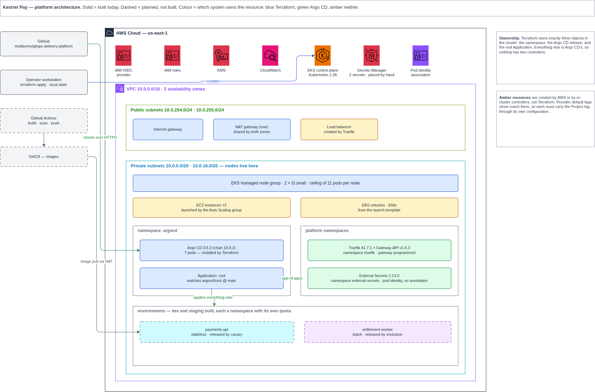
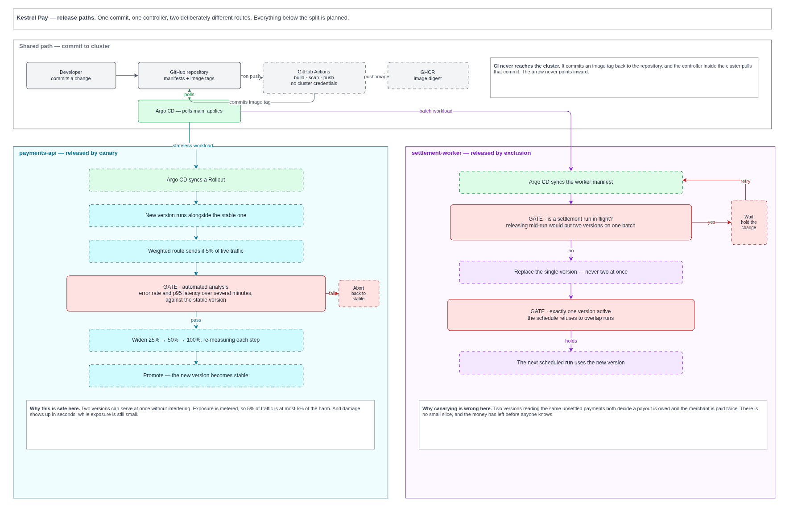

# Architecture

What runs where, which system owns which resources, and where the boundaries
between them sit.

This describes what is built today. The platform provisions a cluster, hands it
over to a delivery controller, and that controller now brings up everything
else: two environments, an ingress path from outside, and a way for a pod to
read a secret held in AWS. It does not yet run an application. That is the
intended stopping point for this stage, not an omission — what is finished is
the machinery an application would arrive into.

## The shape of it

A single AWS region holds one VPC spanning two availability zones. Public
subnets carry the internet gateway and a NAT gateway; private subnets carry
everything else. The managed Kubernetes control plane sits outside the VPC's
subnets but is reachable from them, and two small instances run as worker nodes
in the private subnets.

Inside the cluster, in the order the controller brings them up:

| | what it is |
|---|---|
| routing type definitions | the portable routing API's types, from upstream at a fixed tag |
| ingress controller | the proxy that accepts requests from outside |
| secrets operator | reads secrets out of AWS on the cluster's behalf |
| secret store and requests | which AWS secrets this platform expects to exist |
| `dev`, `staging` | one namespace each, with ceilings on what they may consume |

Solid outlines in the diagrams are built. Dashed outlines are planned. The
colour says which system owns a resource: one for the provisioning tooling, one
for the delivery controller, and one for the things owned by neither, which is
the distinction the next section is about.

## The boundary that matters most

Three systems create things here, and each owns a disjoint set. Nothing has two
owners, and that is deliberate.

**The provisioning tooling owns AWS, and exactly three objects inside the
cluster:** the namespace, the delivery controller's installation, and one
Application resource pointing at a path in this repository. That is the whole
list, it has not grown, and it is not meant to. Every object it owns is an
object the controller must not also manage.

**The delivery controller owns everything else inside the cluster.** The
Application it was pointed at brings up further Applications, one per
component, so adding a component is a new file in a watched directory rather
than a change to the thing that bootstraps everything.

**Neither owns a third category**, and this is the one that causes trouble.
Some resources are created by AWS on its own behalf: the instances behind a
managed node group come from an auto-scaling group rather than from the
provisioning tooling, along with their volumes and network interfaces. Others
are created by controllers running inside the cluster — and there is now one of
those, covered below. None of them appear in any state file.

Why the three-way split is worth drawing: a resource claimed by two systems is
reconciled by two systems. The symptom is an Application that flips between
in-sync and out-of-sync forever, and the cause is invisible from either side.
Keeping the provisioning tooling's footprint inside the cluster to three
objects is what prevents it.

There is one place where two systems deliberately touch the same object, and it
is worth stating because it looks like a violation. The delivery controller's
own secret is created by its installation, and it holds several things: the
console password, the key the controller signs sessions with, and the
certificate it serves with. The secrets operator writes the password in and
leaves everything else untouched.

That is safe for a specific reason rather than by luck. The installation does
not write the password at all — with no password supplied it renders that secret
with no contents whatsoever, and the controller fills in its own password, key
and certificate on first start. So the installation and the operator never
reconcile the same field. This was checked rather than assumed, and had it gone
the other way the whole approach would have needed replacing.

## How a change reaches the cluster

The controller polls this repository and applies what it finds. That is the only
route in, and it is the one rule the rest of the design is arranged around.

There is no image pipeline yet. When there is, it will not reach the cluster
either: it will build an image, push it, and commit the new tag back here, so
the arrow still points outward from the cluster to the repository and never
inward. Nothing is granted cluster credentials in order to deploy, because
nothing needs them — committing is deploying.

The second diagram is mostly about the two workloads this platform exists for,
and why they cannot be released the same way. One is stateless and can have two
versions serving at once while traffic is shifted gradually and measured. The
other pays merchants, and two versions touching the same batch means paying
someone twice — so it is released by ensuring only one version can ever be
active, and only between runs. Neither is built yet, and the specific
thresholds and steps are not yet chosen.

Components come up in a declared order, because some of them are instances of
types that others install. The routing type definitions are applied before the
ingress controller that consumes them, and the secrets operator before the
store definition that is an instance of its types. The ordering is expressed as
a wave number on each component rather than built by hand, and it is the same
problem in both cases: an object cannot be created before the type that defines
it.

### What the repository is authoritative over, exactly

Self-healing is on, so a change made directly against the cluster is reverted
rather than kept. That sentence is true but less sweeping than it sounds, and
the difference is worth knowing before relying on it.

Three things can be done by hand to a running cluster, and they do not behave
the same way:

- **Change a field** on an object the controller manages. Reverted, in about
  two seconds.
- **Delete** an object the controller manages. Recreated, in about two seconds
  — though as a *new* object. Anything that held a reference to the old one is
  pointing at something that no longer exists.
- **Add** an object the repository has never mentioned. **Nothing happens.** It
  stays indefinitely, and the controller reports itself in sync.

The third is the surprising one. Pruning does not mean "delete anything not in
the repository"; it operates on the set of objects the controller already owns,
and an object joins that set by carrying a tracking annotation the controller
writes when it applies something. A hand-made object was never in that set, so
pruning never considers it. The controller is not ignoring it — it has no basis
for thinking it is any of its business.

This was tested rather than assumed. A hand-made ConfigMap survived
indefinitely; given the tracking annotation and nothing else, it was removed
within a second. Ownership decides it, not the kind of object: the namespace
ceilings are ordinary Kubernetes objects too, and they are managed.

So: the repository is authoritative over everything the controller owns, and
silent about everything else. A namespace is not guaranteed to contain only
what the repository says. It is guaranteed not to diverge on what the
repository *does* say. The certificate authority bundle that Kubernetes injects
into every namespace is the standing proof — it has never been mentioned here
and has never been touched.

Two separate loops produce that behaviour and they are easy to conflate. The
controller watches the objects it owns, which is why a hand-made change is
corrected in seconds. Separately it polls this repository on a timer. A change
made by hand is therefore corrected faster than a change committed here
arrives.

## Environments

Environments are namespaces in one cluster, not clusters of their own. Each
gets a namespace, a ceiling on what it may consume, and defaults applied to any
container that does not ask for anything.

Every difference between environments lives in one directory per environment
and nowhere else. The chart that renders an environment is identical for all of
them. The moment a chart differs between environments, there are two charts
wearing one name and the claim that one environment resembles another stops
being checkable.

A namespace is not a security boundary. It separates names and applies quotas;
it does not stop a workload that is trying to reach another. The names here are
`dev` and `staging` rather than anything implying isolation, because implying
it would be a claim that does not survive inspection.

## Getting in from outside

The ingress controller is Traefik, driven through the portable routing API
rather than through its own resource types or the older ingress object. The
familiar choice for years was the community NGINX ingress controller; that
project was retired and archived, and so was its designated successor, so it is
not a default to reach for out of habit.

The portable API matters for a reason that is not about today. Shifting a
fraction of traffic to a new version by weight is expressible in it directly
rather than through vendor-specific annotations — and traffic shifting is what
one of the two workloads this platform exists for will need. Choosing an
ingress controller that could not do it would mean replacing the component
every request passes through, later, under pressure.

The routing type definitions do not ship with the controller's chart. They come
from the upstream project at a fixed tag, standard channel rather than
experimental, applied in an earlier wave.

The administrative console is deliberately not exposed through any of this. It
is reached by forwarding a port, which means reaching it requires cluster
access already.

## Secrets, and how a pod gets AWS permissions

A secret is held in AWS. An operator inside the cluster reads it and
materialises it as an ordinary Kubernetes secret, which a pod consumes like any
other. No secret value and no credential capable of fetching one appears in
this repository.

The operator's own permission to read is the interesting part, because the
usual mechanism could not be used here. That mechanism binds a role to a
service account by annotating the service account with the role's full
identifier — and that identifier contains the AWS account number. The service
account is an object inside the cluster, so the controller owns it, so it has
to be committed, and this repository is public.

So the binding is held on the AWS side instead: a record naming the cluster, a
namespace and a service account name, and the role those three may assume. All
three are ordinary strings that disclose nothing. The service account carries no
annotation and does not know a role exists.

That also fixed a problem the older mechanism has. Its trust policy names the
cluster's identity provider, whose identifier is regenerated every time the
cluster is rebuilt — so a binding written against one rebuild stops working on
the next, silently, presenting as a permissions error. The newer mechanism's
trust policy names a fixed service principal, so there is nothing
cluster-specific in it to go stale. Verified by rebuilding the cluster and
confirming the binding still worked with nothing updated.

The scope, at three levels: the permission reaches one name prefix and cannot
enumerate what else exists; the role is assumable only by the one service
principal; and that principal hands it to exactly one namespace and service
account pair. A pod elsewhere in the cluster does not get reduced access — it
gets no AWS identity at all.

The first real use of this is the delivery controller's own console password. It
used to be generated on first start, and because this platform is torn down
between working sessions, every resume was a first start and the password was
different every time. A hash of a chosen password now lives in AWS and is
written into the controller's secret, so it survives every rebuild. A hash, not
the password: the controller only ever compares against a hash, so the password
itself never needs to exist here.

Honest limits. Once a secret has been materialised into the cluster, the AWS
scoping stops protecting it — anything with permission to read secrets in that
namespace can read it. The AWS boundary protects the secret in AWS; Kubernetes
access control protects the copy in the cluster, and they are separate
mechanisms that fail separately. What this removes is not readability. It is the
bootstrap credential: there is no longer a key that has to be placed by hand and
rotated by hand.

And the operator holds one identity for the whole cluster. The older mechanism
allows a different role per store; this one does not, so every store reads
through the same role and name-prefix scoping is the only scoping available. A
workload that needs its own AWS permissions gets its own binding rather than
wider permissions on the operator's.

Recovery procedures, including what to do when the console password will not
work, are in [runbook.md](runbook.md).

## Cost, and what is tagged

Running costs about **$0.22 an hour**: roughly $0.10 for the control plane,
$0.045 for a single NAT gateway, $0.042 for two small nodes, $0.025 for the
load balancer, and half a cent for a public address. Around $158 a month if
left up, which is why the platform is built to be torn down between working
sessions and rebuilt from this repository. Everything inside the cluster is
reconciled from source control, so rebuilding costs time rather than work.

Two secrets in AWS add about $0.80 a month and are not torn down with the
cluster, deliberately — they are what makes a rebuild produce a working
platform rather than a fresh one.

Every resource the provisioning tooling creates carries a project tag applied
once at the provider level rather than repeated per resource. Two categories
need more than that, and both were found the hard way.

**Instances, volumes and network interfaces** are launched from a template
rather than created directly, so a provider-level default never reaches them.
The template stamps the tag on what it launches, which has to be configured
deliberately. Missing it leaves the compute — the second largest line on the
bill — absent from any report grouped by project.

**Load balancers created from inside the cluster.** Exactly one component here
asks AWS for a resource on its own initiative: the ingress controller, by
declaring a service that needs to be reachable from outside. The cloud
controller that ships with a managed cluster answers that by creating a
balancer. The provisioning tooling never sees it and no provider default
reaches it, so the tags ride on the service's own configuration and are applied
at creation. Confirmed against the live balancer rather than against the
configuration that was supposed to tag it, because those two things have
differed here before.

The secrets operator, for the avoidance of doubt, creates no AWS resources. It
only reads.

One further property of the billing system, which is not about either category
but defeats both on a fresh account. **A tag cannot be activated before it
exists.** A tag key does not appear in
the billing console's list until a resource in the account already carries it,
and activation then takes up to a day to take effect. So the first day or two
of spend on a new account is not attributed, however correct the configuration
is. That is a property of the billing system, not a mistake, and it is stated
here because a cost report that looks complete and is not is worse than no
report.

## What is deliberately absent

No remote state: state is a local file, and the two configurations share only
the cluster's name rather than reading each other's state. No application, no
image pipeline, no database, no metrics, no progressive delivery. Each is
deferred rather than forgotten.

The reasoning behind these, and behind everything above, is in
[decisions.md](decisions.md) — including the costs accepted along the way.

## Editing the diagrams

The source is [`diagrams/kestrel-pay-architecture.drawio`](diagrams/kestrel-pay-architecture.drawio),
a two-page drawing. Open it with [draw.io](https://www.drawio.com), change what
has moved, and export each page again over the images above. A drawing file is
not an image, which is why the exported pictures are committed alongside it.
