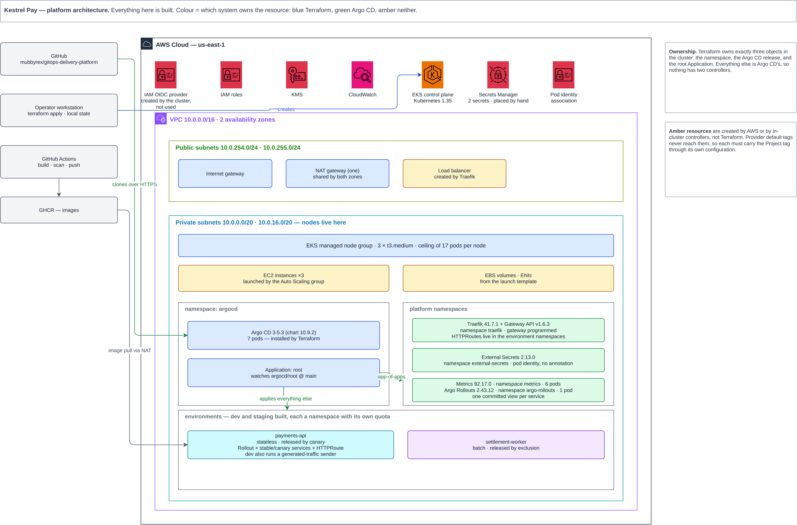
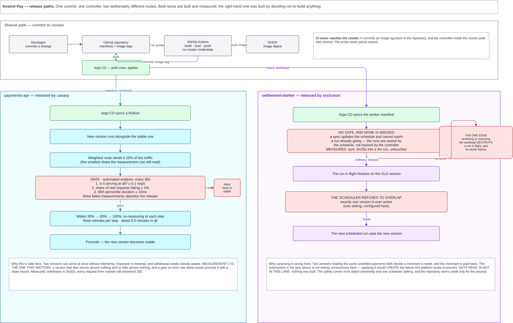

# Architecture

What runs where, which system owns which resources, and where the boundaries
between them sit.

This describes what is built today. The platform provisions a cluster, hands it
over to a delivery controller, and that controller brings up everything else:
two environments, an ingress path from outside, a way for a pod to read a
secret held in AWS, and two services that run.

A change to a service reaches the cluster without anyone applying anything —
edit the source, and a pipeline builds it, scans it, publishes it and commits a
reference, which the controller picks up.

The two services are then released in deliberately different ways, which is the
part this platform exists to demonstrate. The request-serving service arrives
in weighted steps with an automated gate between them. The batch worker arrives
by replacement and must never run twice at once. Both are described below, and
the asymmetry between them is the argument rather than an inconsistency.

## The shape of it



A single AWS region holds one VPC spanning two availability zones. Public
subnets carry the internet gateway and a NAT gateway; private subnets carry
everything else. The managed Kubernetes control plane sits outside the VPC's
subnets but is reachable from them, and three small instances run as worker nodes
in the private subnets.

Inside the cluster, in the order the controller brings them up:

| | what it is |
|---|---|
| routing type definitions | the portable routing API's types, from upstream at a fixed tag |
| ingress controller | Traefik — the proxy that accepts requests from outside |
| secrets operator | External Secrets — reads secrets out of AWS on the cluster's behalf |
| release controller | Argo Rollouts — owns the weighted release of the request-serving service |
| metrics stack | Prometheus, with Grafana and the exporters that feed it |
| log store and collector | Loki, with one collector per node — answers *why* something failed, where the metrics answer *whether* |
| secret store and requests | which AWS secrets this platform expects to exist |
| `dev`, `staging` | one namespace each, with ceilings on what they may consume |
| `payments-api` | in both environments — a long-running workload that scales by replica count |
| `settlement-worker` | in both environments — a scheduled job that must never run twice at once |
| service views | one committed dashboard per service, deployed once rather than per environment |
| generated traffic | **dev only, and not part of the platform** — see the section on where traffic comes from |

Names are given here once because the prose elsewhere uses roles rather than
products — "the delivery controller", "the collector" — on the grounds that the
reasoning transfers and the product may not. That is deliberate, and it costs a
reader who wants to know what was actually run. This table is the answer.

### The cluster installs nothing on its own

The managed service will bootstrap a default set of components — networking,
DNS, the storage driver — unless it is told not to. It is told not to here, and
each component is instead named and pinned to a literal version, with automatic
version tracking switched off.

Two reasons, and the second is the one that matters for a platform about release
safety. Left to resolve each component to whatever is newest at the moment of
the run, an unrelated apply months from now would upgrade the network plugin
underneath a running cluster as a side effect, and two people applying the same
commit would not get the same cluster. Upgrading is therefore an edit, made on
purpose.

**The network plugin has to exist before any node boots**, and is ordered that
way explicitly. Getting this wrong has no error message: the nodes register and
then sit at `NotReady` indefinitely, because a node without a network plugin can
never report ready. Nothing fails and nothing warns — the node group simply
never finishes creating. The DNS component is the opposite case and must come
after, because it runs as ordinary pods that need a node to land on.

Both diagrams are of things that exist; nothing in either is planned any more.
The colour says which system owns a resource: one for the provisioning tooling, one
for the delivery controller, and one for the things owned by neither, which is
the distinction the next section is about.

## The boundary that matters most

Three systems create things here, and each owns a disjoint set. Nothing has two
owners, and that is deliberate.

**The provisioning tooling owns AWS, and exactly three objects inside the
cluster:** the namespace, the delivery controller's installation, and one
Application resource pointing at a path in this repository. That is the whole
list, it has not grown, and it is not meant to. Every object it owns is an
object the controller must not also manage.

**The delivery controller owns everything else inside the cluster.** The
Application it was pointed at brings up further Applications, one per
component, so adding a component is a new file in a watched directory rather
than a change to the thing that bootstraps everything.

**Neither owns a third category**, and this is the one that causes trouble.
Four kinds, and the last is the most consequential in the whole platform.

**Created by AWS on its own behalf.** The instances behind a managed node group
come from an auto-scaling group rather than from the provisioning tooling,
along with their volumes and network interfaces. Provider-level tags never
reach them, which is why the launch template has to stamp tags itself.

**Created by controllers inside the cluster.** The load balancer in front of
the routing layer is made by the cloud controller in response to a Service, so
the provisioning tooling never sees it and its tags ride on an annotation.

**Placed by hand, and never created by anything here.** The two AWS secrets.
The platform does not build without them and this repository does not create
them, because a secret committed is a secret published. They are the only
things that survive a teardown.

**Created by a workload, and owned by it.** Every settlement run. The
repository declares a *schedule*; the runs that schedule creates belong to the
schedule and carry no delivery-controller tracking at all.

That last one is not a detail of bookkeeping. **It is the entire basis of the
batch worker's release guarantee** — a synchronisation updates the schedule's
template and has no relationship with a run already in progress, which is why
a release landing mid-run cannot put two versions on one batch. The section on
releasing the worker sets out what that does and does not cover.

None of these appear in any state file.

Why the three-way split is worth drawing: a resource claimed by two systems is
reconciled by two systems. The symptom is an Application that flips between
in-sync and out-of-sync forever, and the cause is invisible from either side.
Keeping the provisioning tooling's footprint inside the cluster to three
objects is what prevents it.

There is one place where two systems deliberately touch the same object, and it
is worth stating because it looks like a violation. The delivery controller's
own secret is created by its installation, and it holds several things: the
console password, the key the controller signs sessions with, and the
certificate it serves with. The secrets operator writes the password in and
leaves everything else untouched.

That is safe for a specific reason rather than by luck. The installation does
not write the password at all — with no password supplied it renders that secret
with no contents whatsoever, and the controller fills in its own password, key
and certificate on first start. So the installation and the operator never
reconcile the same field. This was checked rather than assumed, and had it gone
the other way the whole approach would have needed replacing.

## How a change reaches the cluster



The controller polls this repository and applies what it finds. That is the only
route in, and it is the one rule the rest of the design is arranged around.

Components come up in a declared order, because some of them are instances of
types that others install. The routing type definitions are applied before the
ingress controller that consumes them, and the secrets operator before the
store definition that is an instance of its types. The ordering is expressed as
a wave number on each component rather than built by hand, and it is the same
problem in both cases: an object cannot be created before the type that defines
it.

A build pipeline now exists, and it does not reach the cluster either. On a
change to a service it builds an image, scans it, publishes it, and commits a
reference back to this repository. That commit is the only way a new version
arrives. Nothing is granted cluster credentials in order to deploy, because
nothing needs them — committing is deploying.

What the pipeline is allowed to do is written out one permission at a time,
with a reason attached to each: read this repository, write a commit to it,
publish a package. Everything else is denied by default rather than left to
whatever the platform grants. It holds no cluster credential, no cloud
credential, and not even the permission that would let it exchange its own
identity for one.

**The reference it commits identifies content, not a name.** A tag can be
repointed at different bytes later, which would mean the running version is not
determined by what is committed. So what lands in the environment file is a
digest, and the chart has no tag field at all to fall back on. The cost is
readability: nobody can tell which version is deployed by looking, and a diff
between two releases shows two meaningless strings.

**It writes to one environment only.** The pipeline commits to development.
Moving a version onward is a human editing a line, because promotion is a
decision and this pipeline does not get to make decisions. The two environments
are therefore expected to differ, and usually do.

The second diagram is about the two workloads this platform exists for and why
they cannot be released the same way. One of them now is: the request-serving
service arrives in weighted steps with a gate between them, described below.
The batch worker still arrives by replacement, and always will — that asymmetry
is the argument this repository exists to make.

### What the repository is authoritative over, exactly

Self-healing is on, so a change made directly against the cluster is reverted
rather than kept. That sentence is true but less sweeping than it sounds, and
the difference is worth knowing before relying on it.

Three things can be done by hand to a running cluster, and they do not behave
the same way:

- **Change a field** on an object the controller manages. Reverted, in about
  two seconds.
- **Delete** an object the controller manages. Recreated, in about two seconds
  — though as a *new* object. Anything that held a reference to the old one is
  pointing at something that no longer exists.
- **Add** an object the repository has never mentioned. **Nothing happens.** It
  stays indefinitely, and the controller reports itself in sync.

The third is the surprising one. Pruning does not mean "delete anything not in
the repository"; it operates on the set of objects the controller already owns,
and an object joins that set by carrying a tracking annotation the controller
writes when it applies something. A hand-made object was never in that set, so
pruning never considers it. The controller is not ignoring it — it has no basis
for thinking it is any of its business.

This was tested rather than assumed. A hand-made ConfigMap survived
indefinitely; given the tracking annotation and nothing else, it was removed
within a second. Ownership decides it, not the kind of object: the namespace
ceilings are ordinary Kubernetes objects too, and they are managed.

So: the repository is authoritative over everything the controller owns, and
silent about everything else. A namespace is not guaranteed to contain only
what the repository says. It is guaranteed not to diverge on what the
repository *does* say. The certificate authority bundle that Kubernetes injects
into every namespace is the standing proof — it has never been mentioned here
and has never been touched.

Two separate loops produce that behaviour and they are easy to conflate. The
controller watches the objects it owns, which is why a hand-made change is
corrected in seconds. Separately it polls this repository on a timer. A change
made by hand is therefore corrected faster than a change committed here
arrives.

## Environments

Environments are namespaces in one cluster, not clusters of their own. Each
gets a namespace, a ceiling on what it may consume, and defaults applied to any
container that does not ask for anything.

Every difference between environments lives in one directory per environment
and nowhere else. The chart that renders an environment is identical for all of
them. The moment a chart differs between environments, there are two charts
wearing one name and the claim that one environment resembles another stops
being checkable.

A namespace is not a security boundary. It separates names and applies quotas;
it does not stop a workload that is trying to reach another. The names here are
`dev` and `staging` rather than anything implying isolation, because implying
it would be a claim that does not survive inspection.

## The two workloads, and why they are shaped differently

Both services are stubs and will stay stubs. Each serves a health endpoint, a
metrics endpoint, and carries a switch that makes it fail on purpose. Neither
computes anything, and the file each lives in says so in its opening paragraph
rather than letting a reader work it out. The asymmetry this platform is about
is in how they are *delivered*, not in what they calculate.

One chart each, identical across environments, with every difference held in a
values file per environment. The shapes differ, and the difference should be
visible from the files rather than needing to be explained:

| | the API | the worker |
|---|---|---|
| kind | long-running | scheduled |
| replica count | present, and meaningful | **absent, not set to one** |
| update strategy | one at a time, never below the desired count | — |
| probes | liveness and readiness, different endpoints | — |
| stable address | yes | none; nothing connects to it |
| retries on failure | — | none |

The missing replica count is the sharpest of these. For the API a second copy
is capacity. For the worker a second copy is the hazard, so the dial does not
exist rather than being set to one and trusted.

### Two probes that look alike and behave nothing alike

The API has a liveness check and a readiness check, pointed at different
endpoints, and the distinction is the most consequential thing in either chart.
Both were broken deliberately and watched.

**Liveness failing gets the container destroyed.** The platform kills and
restarts it, roughly every thirty seconds, indefinitely. Traffic is lost as a
side effect — a restarting container is not ready, so it leaves the service,
returns, and is killed again. Every replica does this independently, and there
is no stable state to observe or roll back from.

**Readiness failing takes traffic away and touches nothing else.** The
container keeps running, keeps answering correctly, and is simply not sent any
work. Nothing is destroyed. Measured over two minutes, the restart count did
not move once.

Pointing both at the same endpoint is the common mistake, and it converts "this
copy is busy" into "restart every copy".

### The stall is the safety property

Readiness failing produced something better than a safe failure. Because the
update strategy never drops below the desired count, the platform will not
retire an old copy until a new one is ready — so when the new copies never
became ready, the release simply **stopped**, with the old ones still serving.

In a real bad release that is the whole game: the new version never qualifies
for traffic, the old version keeps serving, and the deployment freezes rather
than progressing. Nothing is half-applied, so nothing needs undoing; when
readiness passes again the release resumes from where it stopped. That is
release safety arriving from one line of configuration, and it is the
foundation the gradual-release work builds on.

### What the worker does instead

**Its schedule, stated once because three documents refer to it and none of
them said it.** The worker runs **every five minutes in `dev` and hourly in
`staging`**, and a run takes about thirty seconds. So in development it is in
flight roughly a tenth of the time, and the two environments' runs coincide at
the top of every hour. Where a measurement below describes a four-minute run,
the duration was temporarily lengthened to make an observation possible and
then put back — a run is thirty seconds.

It refuses to overlap. One setting, chosen deliberately from three, and nothing
built: if a run is still going when the next falls due, the next is not started
alongside it. Retries are off for the same reason — a retry is a second attempt
over the same batch, which is the same hazard separated in time rather than
running alongside.

The guarantee is narrower than it first appears, and this was established by
making a run outlast its own schedule rather than by reading the documentation:

- A run that is still **going** blocks the next one. Observed.
- A run that has **failed** does not. Failure is terminal, so the slot is free,
  and the next run starts on time.
- A blocked run is **deferred, not discarded.** When the long run finished, the
  run it had blocked started a hundred and three seconds late, because that was
  still inside the window allowed for a late start.

So the property is "never two at once", not "at most one per period". A worker
that consistently overruns pushes each subsequent run later until one finally
exceeds the lateness allowance and is genuinely dropped. The cost is drift
rather than loss, and neither condition is alarmed on yet.

## Releasing the batch worker: what is guaranteed, and where it stops

The request-serving service is released in weighted steps because two versions
can serve at once without interfering. For the settlement worker, two versions
at once **is** the hazard, so it is released by replacement — and the question
that matters is what happens if a release lands while a run is in progress.

### The guarantee

> A release applied while a settlement run is in flight cannot change that run.
> The run completes on the version it started with, and the next scheduled run
> uses the new version.
>
> This holds because the repository declares a **schedule**, and the runs that
> schedule creates are owned by it rather than tracked by the delivery
> controller. A synchronisation updates the schedule's template and has no
> relationship with a run already in progress.
>
> **It does not hold if the release removes or renames the schedule itself.**

That is written as a claim with a mechanism attached because it can then be
checked, and because the mechanism is the part people get wrong.

Measured rather than asserted: a synchronisation landed three minutes
twenty-five seconds into a four-minute run. The run's identifier did not
change, its image did not change, and it finished normally on the old version
while the schedule picked up the new one for next time.

### Who actually provides it

This is the uncomfortable part, and stating it is the point.

| part of the guarantee | provided by | configured here? |
|---|---|---|
| a sync cannot reach a run already going | object ownership | **no** |
| two runs never overlap | the scheduler's concurrency setting | yes |
| a failed run is never retried over the same batch | the absence of retries | yes |

Only the second and third are decisions this repository made. The first — the
one that makes a release safe mid-run — is how ownership works in Kubernetes.
Nothing here configured it and nothing here should take credit for it.

That distinction matters more than it looks. A platform that cannot tell its
inherited properties from its engineered ones will eventually defend the wrong
one, or rebuild something it already had.

### Where it stops

**Renaming or removing the workload destroys a run in flight.** The runs carry
an owner reference back to the schedule with deletion blocking set, so removing
the schedule takes them with it. A rename is exactly that: the delivery
controller sees one object newly declared and one no longer declared, creates
the first and removes the second.

Demonstrated rather than inferred from the field. A run four seconds old was
destroyed, and so was the entire retained history of previous runs.

That second loss compounds the first. The worker's health is answered from the
cluster's record of its finished runs, because the process cannot report its
own outcome — it writes the result in the instant before it exits. Deleting
that record leaves the indicator with nothing to read, which looks identical to
a worker that has silently stopped. **The failure erases the evidence of
itself.**

And through all of it the delivery controller reported the application healthy,
correctly by its own definition: what is committed is what is running. It has
no concept of a batch of payments abandoned half-way.

So the practical rule, which now sits in the chart beside the line it concerns:
changing the image is safe at any moment, and changing the name is not.

### What is not covered

A run whose pod dies part-way — evicted, drained, or killed by the node —
leaves a batch half-settled, and nothing described here addresses it. Retries
are deliberately off, so the work is not reattempted; the next run starts
fresh. Whether that is safe depends on whether settling the same batch twice is
harmful, which in this scenario it is.

That is recovery, and it is deliberately a separate problem from release
safety. It is named here rather than left as an implication, because a reader
who takes "releases are safe" to mean "runs are safe" has been misled by
omission.

## Is it healthy? Where the answer comes from

A collector runs in the cluster, gathers numbers from both services, and keeps
them for a day. There is one place to look per service, and each is built from
indicators that were chosen and written down before any of them had a number
attached.

**What is scraped is declared next to the thing it describes**, not listed in a
file the collector is configured with. Each service's chart carries its own
scrape definition, so adding a third service later is a file in that service's
chart rather than an edit to something central that nobody remembers owns the
list. The collector is installed with its selectors left empty, which is what
makes that sufficient: it picks up any such definition in any namespace rather
than only the ones belonging to its own release.

### The two services need different answers, and one of them is not its own

The request-serving API is the familiar shape, so the familiar numbers apply:
how many requests, how many failed, how long they took. Those come from the
service itself.

The batch worker cannot be asked the same way, and finding out why changed
where its numbers come from. It exposes a run outcome and a run duration, and
both are written in the instant before the process exits. Scraping a live run
returns neither: the outcome counter has no series yet, because a labelled
counter has none until its label is first used, and the duration still reads
zero. Then the process exits and takes its endpoint with it.

Measured against a real run, the service reported a duration of **0** while the
cluster's record of the same run reported **34 seconds**. The information was
never missing. It was being asked of the wrong thing.

So the worker's indicators are read from the cluster's record of its runs,
which outlives the pod that did the work, and the service's own metrics are a
supplement. That is the inverse of how the API is measured, and the inversion
is not a preference — it follows from one process staying still and the other
not.

The standard remedy for a short-lived job is to have it push its numbers to a
component that stays running. That was considered and declined: the facts are
already recorded in the cluster, and installing something to re-learn them
would be machinery serving a need that has not been demonstrated. The cost is
that a run interrupted part-way and a run that failed outright become the same
thing, because the cluster does not draw a distinction the service does.

### The indicator that catches a failure nothing else can

For the worker, the number read first is **how long since a run last
succeeded**, compared against how often runs are due.

Counters move when something happens. Nothing moves when nothing happens — so a
worker that silently stops being scheduled produces no failures, no errors and
no change in any total. The numbers simply stop, and a stopped number is
indistinguishable from a quiet one. Elapsed time since the last success is the
only indicator here that treats absence as a signal, and absence is this
workload's most likely silent failure.

### Idle must not look like healthy, and once it did

Every rate the API exposes reads zero when nobody is calling it, so a perfectly
healthy idle service produces the same numbers as one that is unreachable or
gone. That is why the first thing on its view is whether the service is
*there* — scrape targets answering, and replicas the cluster considers
available — which is a different question from whether it is *succeeding*.

The first version of this got it wrong in the opposite direction, and only
breaking the service on purpose revealed it. The request counter records every
request the process serves, and the cluster probes it constantly for liveness
and readiness. So an idle service reported a steady rate of successful requests
that was entirely the cluster talking to itself, and a service nobody was
calling looked busy. Worse, when the readiness probe was made to fail, those
failures landed in the same counter and the view reported a fifth of requests
failing — reading as users being served errors, when no user was involved and
the previous version was serving every real request without fault.

The views now exclude the probe paths. That restores the problem of zero
meaning two things rather than removing it, which is the right trade: a number
that is honestly ambiguous is easier to reason about than one that is
confidently wrong.

### What breaking it deliberately showed

Each failure the services can be put into produces a different answer, and the
difference is the distinction the whole platform is arranged around.

| | readiness fails | liveness fails |
|---|---|---|
| scrape targets answering | 3 | 0 |
| replicas available | 2 | 0 |
| replicas carrying the new version | 1 | 2 |
| container restarts | 0 | 15 |

A readiness failure does not take the service down. The previous version keeps
serving every request, the deploy simply stops part-way, and the only trace is
updated replicas falling below desired and targets exceeding available. A
liveness failure takes it down: the container is killed and restarted until
nothing is answering at all.

That difference is the safety property made visible. Before this, both were
"the deploy didn't work".

### No number in a view is declared too high

Nothing in any view says a rate is too great or a run too late, and that is
still true. Those are release decisions, and they now live with the thing that
acts on them — the gate described under "How a new version arrives" — rather
than with the thing that describes the service.

The separation was deliberate and it paid. Because no threshold existed while
the indicators were being chosen, the numbers could be chosen later against a
service that had already been described, instead of being reverse-engineered
from whatever made a release pass.

### The measurements do not survive the platform

Nothing claims persistent storage. The collector's database lives in a
directory belonging to its pod and is deleted with it, so a reschedule loses
the history, never mind a teardown. Retention is a day, set explicitly, because
the cluster is parked between working sessions and no measurement can outlive
the cluster that recorded it — the chart's own default of ten days would have
been a claim this platform cannot keep.

This is a decision rather than an oversight, and the cost is real: every figure
quoted above was taken from a cluster that no longer exists. They are preserved
as text written down at the time. Nobody can re-run those queries, and if one
of them is wrong, the evidence that would correct it is gone.

## How a new version arrives

For the request-serving service, a new version is no longer a replacement. It
is a sequence: run it beside the version already trusted, give it a small share
of real traffic, measure what it does with that share, and either widen or
withdraw.

```
  a commit changes the image digest
            │
            ▼
  the delivery controller applies a Rollout, not a Deployment
            │
            ▼
  10% of traffic ──▶ measure 3 min ──▶ 30% ──▶ measure ──▶ 60% ──▶ measure ──▶ 100%
                           │                      │                   │
                           └──────── any of these fails ──────────────┘
                                             │
                                             ▼
                              all traffic back to the previous version
```

The share each version receives is written on the route object by the release
controller and realised by the router. It is therefore observable from outside
the cluster rather than only in configuration: asking the service which version
answered, two hundred times at a sixty percent weight, returned the new version
on 61.0 percent of them.

### The numbers, and why those

**Ten percent first, and the reason is the measurement rather than the
exposure.** At the traffic this platform generates, ten percent gives the
candidate about half a request a second — roughly fifty-eight requests in a
measurement window. That is the smallest sample in which a failure can still be
told apart from silence. At five percent the window holds twenty-nine requests
and a single failure is 3.4 percent of the sample, so the measurement becomes
coarser than any threshold worth setting, and a failing version is **more**
likely to clear the first gate and reach a weight where it does more harm.
Below a certain point, a smaller first step makes a release less safe.

**Three minutes at each step** is six scrapes at the collector's thirty-second
interval. Two minutes gives four samples and one gives two, and a rate computed
from two samples is a difference rather than a rate. A longer pause costs
release time but not exposure, because how fast a release is abandoned is set
by the gate's own interval and tolerance rather than by how long a passing step
waits.

A complete release takes about nine and a half minutes against the under-one-
minute a plain replacement would take. That is what is being bought: three
chances to notice a problem while most traffic is still on the version that
works.

### What the gate measures, and the one that matters

Three measurements every thirty seconds, with a one-minute warm-up so the first
is not taken against an empty window. Three failed measurements abandon the
release.

1. **Is the candidate serving at all?** At least 0.1 requests a second.
2. **What share of its real requests failed?** At most one percent.
3. **How long did they take?** A 95th percentile under ten milliseconds.

The first exists because of something discovered by reading the service
closely: both of its failure switches act on the health endpoints, and the
handler that serves requests returns success unconditionally. A candidate that
cannot stay up serves almost nothing — and therefore **fails** almost nothing.

To a query that counts failures, "answering everything correctly" and "not
answering" are the same answer.

That is not theoretical. A version was released with its liveness check failing.
It became ready, took traffic, and then died repeatedly — six restarts. Its
error share passed every measurement with a clean record, because the handful of
requests it managed between restarts all succeeded. What withdrew it was the
first measurement, reading 0.014 requests a second against a floor of 0.1.

**A gate built on error rate alone would have promoted that version to stable
on the strength of having never failed a request.**

The same shape has now appeared three times in this platform: a sum over a
selector matching nothing returns no series rather than zero; a scheduled job
that stops being scheduled increments no failure counter; a release candidate
that cannot serve reports a clean record. Every measurement of failure needs a
companion measurement that the thing is running at all.

The third measurement is nearly blind and is kept anyway. Every request this
service has ever served fell inside the histogram's smallest bucket of five
milliseconds, and the true mean is nine microseconds, so the reported percentile
is interpolation rather than measurement. It can only detect a regression large
enough to cross five milliseconds — a factor of about five hundred. The limit is
in the bucket boundaries chosen when the metric was added, not in the threshold,
and it is written down rather than hidden behind a precise-looking number.

### Two failures, two different things catching them

| how a version fails | what stops it | does the gate run? |
|---|---|---|
| never becomes ready | readiness, plus the controller refusing to weight an unready candidate | **no — it never runs** |
| becomes ready, then dies | the gate's first measurement | yes |

The first was a surprise and is worth being plain about. A version whose
readiness check fails is never sent a request, so the release never leaves its
first step and the gate is never reached. The release was stopped by
capabilities this platform already had before any of this was built. **The most
likely way a version fails is caught for free; the gate is for the one that
isn't.**

Neither substitutes for the other, and a reader who installs only the gate
would be covering the rarer case.

### Going back is not a release

Restoring a previous version does not creep through the weights. The controller
recognises a return to the version that was already trusted and goes straight
there.

That asymmetry is correct: forward is gradual because the destination is
unproven, and back is immediate because the destination is the version that was
working. A rollback that crawled through the same schedule would keep users on
the broken version for the length of it.

### Synchronisation does not fight a withdrawal

Automatic synchronisation with drift correction is the property this whole
platform is arranged around, and an abandoned release is, by construction, a
cluster that has declined to run what the repository asks for. The two do not
collide. Across two withdrawals the delivery controller reported the
application **synced** while the release sat degraded, because synchronisation
compares specifications and a refusal lives in status.

Nothing was excluded from comparison to achieve this. It works because the
repository declares no traffic weight at all and declares each address without
the key the controller adds, so the fields the controller writes are fields
nothing else has ever claimed.

### The batch worker is not in any of this, and that is the point

It has no rollout, no traffic weight, no gate and no route. Its chart is
unchanged by this work, confirmed by comparing it against the state before the
work began.

The reason is the thing this repository exists to argue. A weighted release
runs two versions of a service at once, briefly and on purpose. For the
settlement worker, two versions running at once **is the hazard** — the same
batch settled twice, a merchant paid twice. The mechanism described above is
not merely unnecessary for that workload; applying it would create exactly the
failure the platform is built to prevent.

A reader who notices that one service canaries and the other does not should
not conclude the second is unfinished. The absence is the design. What the
worker does instead — refuse to overlap, and never retry — is described above
under the two workloads.

### Where the traffic comes from, and the thing that must be said about it

This platform has no users. The request rates quoted above come from a
generator running inside the cluster, sending about five requests a second
through the front door with the host name a real client would use.

It exists because a release gated on the share of requests failing needs
requests to take a share of, and a share of nothing is not a measurement. It
sends through the router rather than at the service, because load sent straight
at a service bypasses the weighting entirely and would keep arriving at both
versions whatever the release was doing — every number would look reasonable
and none of them would be about the release.

It is the one component here that would not exist in a real deployment, and it
is named, labelled and listed as what it is. **No real user traffic has ever
reached this platform.** A graph is more persuasive than a caveat, which is why
the caveat is in four places.

## Getting in from outside

The ingress controller is Traefik, driven through the portable routing API
rather than through its own resource types or the older ingress object. The
familiar choice for years was the community NGINX ingress controller; that
project was retired and archived, and so was its designated successor, so it is
not a default to reach for out of habit.

The portable API matters for a reason that is not about today. Shifting a
fraction of traffic to a new version by weight is expressible in it directly
rather than through vendor-specific annotations — and traffic shifting is what
one of the two workloads this platform exists for will need. Choosing an
ingress controller that could not do it would mean replacing the component
every request passes through, later, under pressure.

The routing type definitions do not ship with the controller's chart. They come
from the upstream project at a fixed tag, standard channel rather than
experimental, applied in an earlier wave.

The administrative console is deliberately not exposed through any of this. It
is reached by forwarding a port, which means reaching it requires cluster
access already.

## Secrets, and how a pod gets AWS permissions

A secret is held in AWS. An operator inside the cluster reads it and
materialises it as an ordinary Kubernetes secret, which a pod consumes like any
other. No secret value and no credential capable of fetching one appears in
this repository.

The operator's own permission to read is the interesting part, because the
usual mechanism could not be used here. That mechanism binds a role to a
service account by annotating the service account with the role's full
identifier — and that identifier contains the AWS account number. The service
account is an object inside the cluster, so the controller owns it, so it has
to be committed, and this repository is public.

So the binding is held on the AWS side instead: a record naming the cluster, a
namespace and a service account name, and the role those three may assume. All
three are ordinary strings that disclose nothing. The service account carries no
annotation and does not know a role exists.

That also fixed a problem the older mechanism has. Its trust policy names the
cluster's identity provider, whose identifier is regenerated every time the
cluster is rebuilt — so a binding written against one rebuild stops working on
the next, silently, presenting as a permissions error. The newer mechanism's
trust policy names a fixed service principal, so there is nothing
cluster-specific in it to go stale. Verified by rebuilding the cluster and
confirming the binding still worked with nothing updated.

The scope, at three levels: the permission reaches one name prefix and cannot
enumerate what else exists; the role is assumable only by the one service
principal; and that principal hands it to exactly one namespace and service
account pair. A pod elsewhere in the cluster does not get reduced access — it
gets no AWS identity at all.

The first real use of this is the delivery controller's own console password. It
used to be generated on first start, and because this platform is torn down
between working sessions, every resume was a first start and the password was
different every time. A hash of a chosen password now lives in AWS and is
written into the controller's secret, so it survives every rebuild. A hash, not
the password: the controller only ever compares against a hash, so the password
itself never needs to exist here.

Honest limits. Once a secret has been materialised into the cluster, the AWS
scoping stops protecting it — anything with permission to read secrets in that
namespace can read it. The AWS boundary protects the secret in AWS; Kubernetes
access control protects the copy in the cluster, and they are separate
mechanisms that fail separately. What this removes is not readability. It is the
bootstrap credential: there is no longer a key that has to be placed by hand and
rotated by hand.

And the operator holds one identity for the whole cluster. The older mechanism
allows a different role per store; this one does not, so every store reads
through the same role and name-prefix scoping is the only scoping available. A
workload that needs its own AWS permissions gets its own binding rather than
wider permissions on the operator's.

Recovery procedures, including what to do when the console password will not
work, are in [runbook.md](runbook.md).

## Cost, and what is tagged

Running costs **between $0.35 and $0.42 an hour**, measured on 2026-11-19 from
two separately billed days in `us-east-1`, rather than assembled from published
rates. Approximate, region-dependent, and it will age.

| | 2026-11-15 | 2026-11-16 |
|---|---|---|
| hours the cluster was up | 4.26 | 1.36 |
| three nodes | $0.121/hr | $0.096/hr |
| cluster control plane | $0.100/hr | $0.100/hr |
| **address translation, storage, data** | **$0.108/hr** | **$0.203/hr** |
| load balancing | $0.024/hr | $0.018/hr |
| **total while running** | **$0.353/hr** | **$0.417/hr** |

**The rate is not constant, and the reason is worth more than the number.**
Every line above is billed per hour except one. Address translation is charged
per gigabyte processed, and a rebuild pulls every container image the platform
runs through that gateway. On a long working session that cost spreads over
many hours; on a short one it does not. So **a short session costs more per
hour than a long one**, and the shorter it is the worse the ratio.

That also means the figure rises with activity rather than with what is
installed — which is the opposite of how a cluster's cost is usually assumed to
behave, and it is why every estimate in this repository before this one was
low. They were built from instance and control-plane rates, the prices that are
easy to look up, and omitted the two lines metered by use.

The number is traceable to decisions rather than being a fact of nature. One
NAT gateway instead of one per availability zone, a public API endpoint that
avoids running a bastion, the smallest instances that clear the per-node pod
ceiling, and a third node bought against a measured peak — each is recorded in
[decisions.md](decisions.md) with what it costs.

**What continues after a teardown is not zero.** About **$0.03 a day**, or
roughly **$0.89 a month** — the two secrets are about $0.80 of that and the key
that encrypts them the rest. They are the only things in this platform that survive on purpose, and
they survive because the delivery controller's own password lives in one of
them — without it, a rebuilt cluster would come up with a different password
every time.

Ten encryption keys from previous builds also remain, one per cluster ever
created. All are pending deletion rather than active, and pending keys are not
billed — checked rather than assumed. They disappear on their own.

The nodes were the most recent thing to change, and the reason is worth stating
because it is the normal life of a sizing decision rather than a correction. The
original pair were the cheapest instances that cleared the pod-per-node ceiling
the networking plugin imposes. Once the platform components alone occupied
nineteen of the twenty-two available slots, there was no room for the workloads
the cluster exists to run, and the sizing that had been right became the sizing
that had been outgrown.

Processes added to nodes that are already paid for do not change the hourly
cost. What they consume is room, and room ran out.

The pod ceiling is set by addresses rather than by processor or memory: the
networking plugin gives each pod an address from the node's own interfaces, so
the instance type caps how many pods a node can run long before anything else
is exhausted. Each node here allows **seventeen**.

Counted on the running cluster at each point it mattered:

| | nodes | slots | used | free |
|---|---|---|---|---|
| before progressive delivery, at rest | 2 | 34 | 28 | 6 |
| before, with a batch run in flight in both environments | 2 | 34 | 30 | 4 |
| after a third node, at rest | 3 | 51 | 32 | 19 |
| **with a release running and batch runs overlapping** | 3 | 51 | 36 | **15** |

A third node was added when the arithmetic stopped working: a release
controller, a traffic generator and a second copy of a service during a release
came to more than the four free slots that remained at the worst moment, and a
namespace ceiling that is exactly met rejects the next pod rather than
queueing it.

The margin came out larger than planned, and the reason is worth keeping. The
estimate assumed a candidate version scales with its traffic share; it scales
with the replica count, so at any weight below a hundred percent a two-replica
service produces **one** extra pod rather than two. Fifteen free where four
were planned for.

Every resource the provisioning tooling creates carries a project tag applied
once at the provider level rather than repeated per resource. Two categories
need more than that, and both were found the hard way.

**Instances, volumes and network interfaces** are launched from a template
rather than created directly, so a provider-level default never reaches them.
The template stamps the tag on what it launches, which has to be configured
deliberately. Missing it leaves the compute — the second largest line on the
bill — absent from any report grouped by project.

**Load balancers created from inside the cluster.** Exactly one component here
asks AWS for a resource on its own initiative: the ingress controller, by
declaring a service that needs to be reachable from outside. The cloud
controller that ships with a managed cluster answers that by creating a
balancer. The provisioning tooling never sees it and no provider default
reaches it, so the tags ride on the service's own configuration and are applied
at creation. Confirmed against the live balancer rather than against the
configuration that was supposed to tag it, because those two things have
differed here before.

The secrets operator, for the avoidance of doubt, creates no AWS resources. It
only reads.

One further property of the billing system, which is not about either category
but defeats both on a fresh account. **A tag cannot be activated before it
exists.** A tag key does not appear in
the billing console's list until a resource in the account already carries it,
and activation then takes up to a day to take effect. So the first day or two
of spend on a new account is not attributed, however correct the configuration
is. That is a property of the billing system, not a mistake, and it is stated
here because a cost report that looks complete and is not is worse than no
report.

## What this platform does not do

Seven phases of decisions produced a platform with real limits. They are
collected here rather than scattered, so that a reader can find out what is
missing in one sitting instead of inferring it from silence.

Each of these was raised, considered, and left undone on purpose. None is a
backlog item.

The smaller absences first, since they are quickly said. There is no remote
state — state is a local file, and the two configurations share only the
cluster's name rather than reading each other's. There is no blue/green
release, no service mesh, and no promotion to a second environment by anything
other than a person editing a line. The batch worker has **no database**: it
was considered and refused, because establishing what it stores produced no
answer, and storage added anyway would have been storage invented to justify
the mechanism for reaching it.

The rest are larger.

### A settlement run that dies part-way is not recovered

Retries are off, deliberately: a retry is a second attempt over the same batch,
which is the same hazard as two versions, separated in time. So a run whose pod
is evicted or killed leaves its batch half-settled, and the next run starts
fresh over whatever it finds.

Whether that is safe depends on whether settling a batch twice is harmful,
which in this scenario it is. **The platform prevents the hazard it was built
to prevent and does not recover from this one.**

Fixing it means the worker knowing what it already settled, which means
persistent state, which means the payment logic this project has refused to
write since the services were created. The refusal is recorded; this is its
consequence.

### Nothing protects the worker's release guarantee

A release landing mid-run cannot disturb that run, and the reason is object
ownership rather than anything configured here. That is stated plainly in the
section on releasing the worker.

The consequence is that **nothing in this repository defends it**. Move the
worker from a schedule to a long-running process, a queue consumer, or anything
that holds state between runs, and the property is gone silently. No test
fails, because there is no test — the guarantee is a property of how the
objects are owned, not of anything this repository asserts.

### The routing layer is reachable from the internet without restriction

The cluster's API endpoint is restricted to an explicit list of addresses that
has no default and must be supplied on every build. The load balancer in front
of the routing layer has no equivalent.

So while the platform is up, anyone who knows the balancer's address and sends
the right host header gets a reply. Today that reply is a stub saying it
settles nothing, there is no data behind it and no credential to steal — but
the two doors into this platform are governed differently and only one of them
says so.

Closing it is a few lines restricting the balancer's source addresses. It was
found late and left undone because adding capability in the final phase is how
a boundary gets quietly moved.

### No logs

Measurements answer whether a service is healthy. Logs answer why it is not,
and that is a different piece of work with its own storage and its own cost.

The gap is concrete: when a view shows a settlement run failed, nothing here
says what it failed on. That question ends at the cluster's record of the run.

### No alerting

Every condition described in this document is visible to somebody looking. None
of them wakes anybody.

The notification component that ships with the metrics stack is switched off
rather than installed and left unconfigured, because a component that reports
healthy while delivering nowhere is worse than an absent one.

A number that decides a release and a number that wakes somebody are different
decisions, and only the first has been made here.

### The double payment is prevented and never shown

The hazard this whole platform is arranged around — two settlement runs paying
a merchant twice — is described in the scenario and never demonstrated.

What is demonstrated is that two runs cannot occur: the prevention, not the
harm it prevents. Showing the harm would need the payment logic this project
does not write. The gap is permanent and is better stated than papered over.

The reasoning behind all of these, and behind everything above, is in
[decisions.md](decisions.md) — including the costs accepted along the way.

## Editing the diagrams

The source is [`diagrams/kestrel-pay-architecture.drawio`](diagrams/kestrel-pay-architecture.drawio),
a two-page drawing. Open it with [draw.io](https://www.drawio.com), change what
has moved, and export each page again over the images above. A drawing file is
not an image, which is why the exported pictures are committed alongside it.
