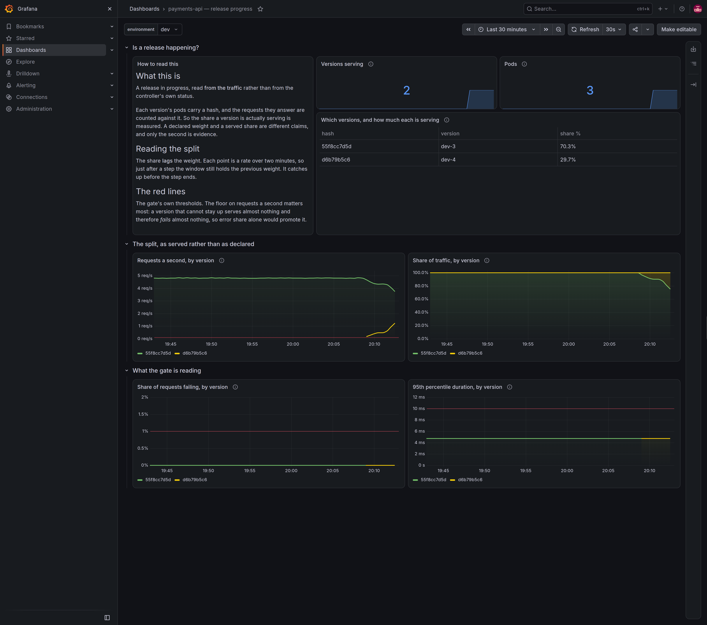
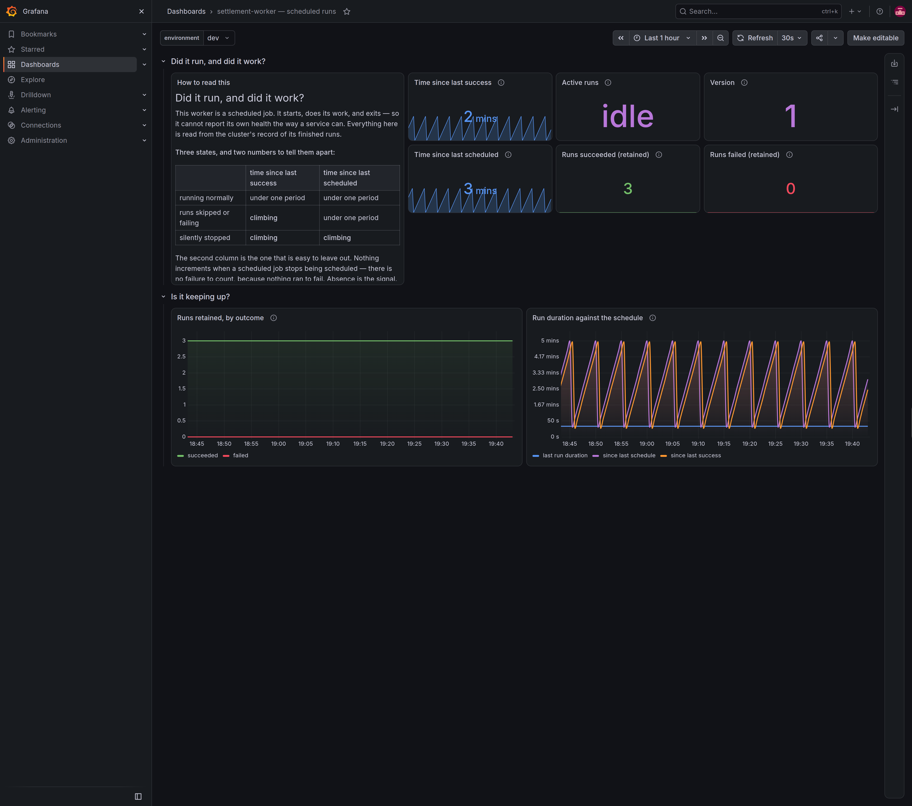
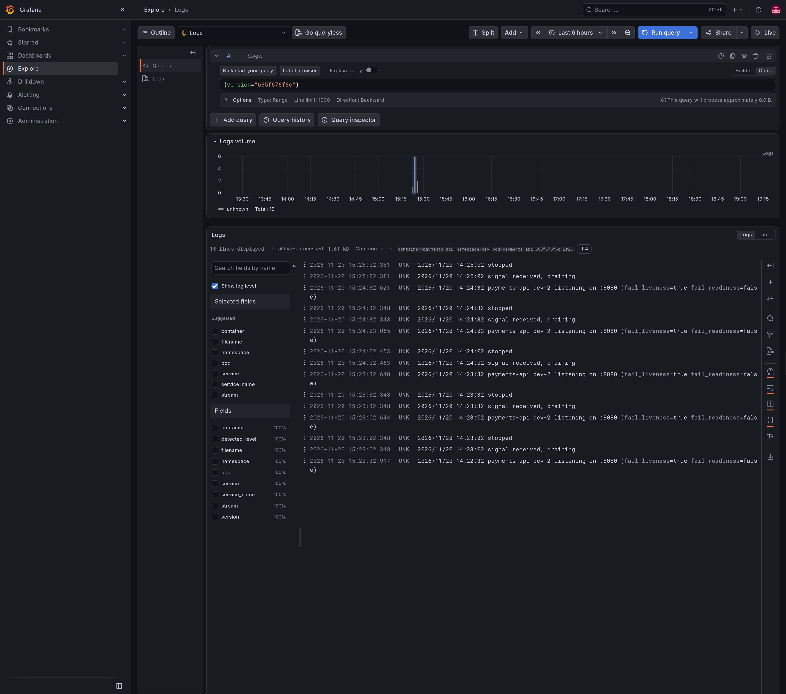

# Evidence

Three images from a running platform, captured **2026-11-20**. They exist
because the claims in this repository are otherwise numbers quoted in prose by
the person asking to be believed, and the reader this is written for does not
have a cluster and will never open a dashboard.

Each one is dated, says what produced it, and is referenced from the document
that makes the claim. They will age — the platform is torn down between
sessions and these show one particular afternoon.

---

## A release, as served rather than as declared

**Dashboard:** *payments-api — release progress*, `dev`, captured **during** a
release rather than after one.

Two versions are serving at once. `dev-3` holds 70.3% and `dev-4` — the
candidate, four minutes old — holds **29.7%**, against a weight the controller
declared as 30%. Three pods: two on the trusted version, one on the version
being tried.

A canary costs one pod, not two. Any weight below 100% rounds a two-replica
service to a single candidate, which is why the pod count reads three rather
than four.

**The point of this image is that the split is measured, not declared.** Each
version's pods carry a hash; the requests they answer are counted against it.
The controller's own claim about the weight is not used anywhere on this page.
A declared weight and a served share are different claims and only the second
is evidence.

The two lower panels are the gate's own measurements with its thresholds drawn
in red: one percent of requests failing, and a 95th percentile of ten
milliseconds. Both sit flat on the floor for the whole release, which is the
expected and correct reading — and is also why the gate does not rely on them
alone. See the next image.

## The batch worker, which is released the opposite way

**Dashboard:** *settlement-worker — scheduled runs*, `dev`, last hour.

No weights, no split, no gate. This workload is never released gradually,
because two versions running at once is the failure rather than a mitigation.

**The panel worth reading is the three-state table on the left**, and the second
column in it. A scheduled job that silently stops being scheduled produces no
failures to count — nothing ran, so nothing failed. *Time since last success*
climbs in that case, and so does *time since last scheduled*, and it is the
second that separates "stopped" from "skipped". That indicator was in neither
the original prediction nor the first proposal.

`Runs failed (retained)` reads zero, and the chart below shows the failure
series flat on zero rather than stacked on top of the successes. That is
deliberate: a stacked series sitting at zero is drawn at the height of the one
below it, so zero failures rendered at the success count until it was fixed.

## A withdrawn release, explained after its pods were gone

**Grafana Explore**, logs datasource, query `{version="665f676f6c"}`, last six
hours.

That hash is a version the gate withdrew automatically. By the time this was
captured its pods had been deleted for hours.

Fifteen lines, five streams — one per container restart. The cycle is legible:
the process comes up announcing `fail_liveness=true`, is killed thirty seconds
later, and does it again, five times.

**This is the image that justifies collecting logs at all.** The metrics
established that the candidate was not serving — 0.016 requests a second
against a floor of 0.1. They could not say *why*, and at that rate a crash
loop, a wedged process and a misrouted weight look identical. The first log
line names the cause.

Before this, the one failure this platform automates was the one that left
nothing to read afterwards: the controller scales the candidate to zero and the
pod is deleted about 48 seconds later, taking its output with it.

**On the two timestamps.** Each line shows Grafana's own time and then the
timestamp the service wrote, an hour apart. The first is the browser's local
zone, the second is UTC. Not a defect.
